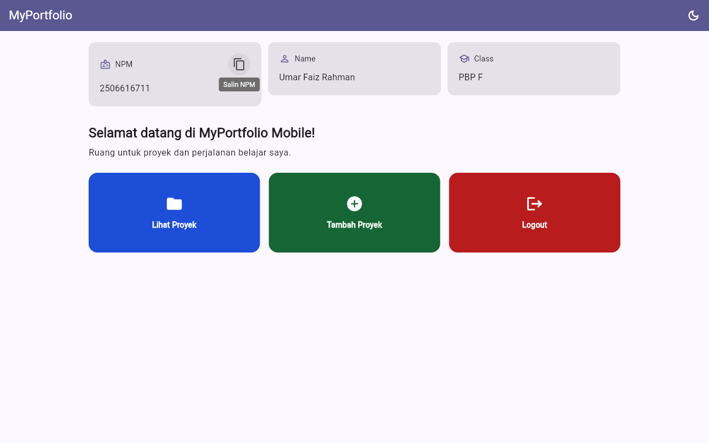
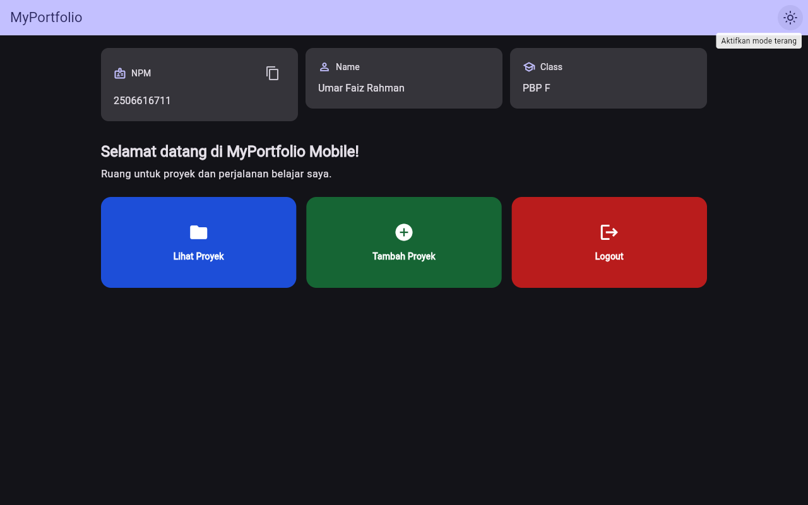
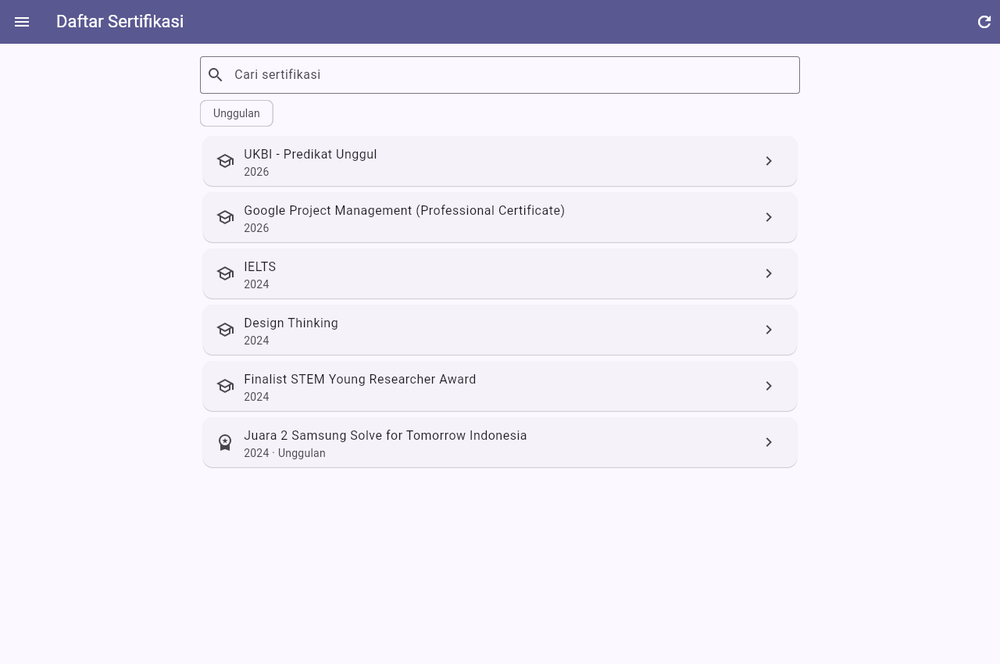

# MyPortfolio Mobile

[](https://github.com/McKenzy65/myportofolio_mobile-/actions/workflows/main.yaml?query=branch%3Amain)

Portofolio Flutter milik **Umar Faiz Rahman**, NPM **2506616711**, kelas **PBP F**. Pengunjung dapat membuka proyek dan sertifikasi dari Django. Pemilik dapat login dan menambah entri. Tugas 7 membangun halaman utama, Tugas 8 menambahkan formulir sertifikasi, Tutorial 10 menghubungkan proyek ke Django, dan Assignment 9 menghubungkan sertifikasi ke API yang sama. [Refleksi dan pengujian Assignment 9](#assignment-9)

## Menjalankan aplikasi

Proyek memakai Flutter **3.47.9** dan Dart **3.13.7**. Backend menjalankan Django **5.2** dengan Django REST Framework. Kode backend, data sertifikasi publik, dan tampilan web bisa dibuka melalui tautan berikut.

| Sumber | Tautan |
| --- | --- |
| Backend Django | [McKenzy65/myportofolio](https://github.com/McKenzy65/myportofolio) |
| API sertifikasi di PWS | [Daftar sertifikasi dalam JSON](https://umar-faiz-myportofolio.pws.cs.ui.ac.id/api/v1/certifications/?format=json) |
| Halaman web Django | [Sertifikasi portofolio](https://umar-faiz-myportofolio.pws.cs.ui.ac.id/certifications/) |
| CI dan unduhan APK | [Buka run dari cabang main, lalu pilih artefak app-release-apk](https://github.com/McKenzy65/myportofolio_mobile-/actions/workflows/main.yaml?query=branch%3Amain) |

**Terminal 1 · Backend lokal.** Perintah PowerShell berikut dimulai dari folder induk tempat kedua proyek akan disimpan. Jika sudah punya salinan repositorinya, masuk langsung ke folder backend. Untuk menguji pembuatan entri, buat superuser khusus pengujian di basis data SQLite lokal.

```powershell
git clone https://github.com/McKenzy65/myportofolio.git portofolio
cd portofolio
py -m venv env
.\env\Scripts\python.exe -m pip install -r requirements.txt
.\env\Scripts\python.exe manage.py migrate
.\env\Scripts\python.exe manage.py createsuperuser
.\env\Scripts\python.exe manage.py runserver
```

**Terminal 2 · Flutter.** Buka PowerShell baru di folder induk yang sama. Jika repositori mobile sudah tersedia, mulai dari folder proyek yang memuat `pubspec.yaml`.

```powershell
git clone https://github.com/McKenzy65/myportofolio_mobile-.git myportofolio_mobile
cd myportofolio_mobile
flutter pub get
dart run build_runner build
flutter run -d chrome --dart-define=API_BASE_URL=http://localhost:8000
```

Untuk emulator Android, pilih emulator saat menjalankan `flutter run`. Nilai bawaan `http://10.0.2.2:8000` mengarah ke server pada komputer host. Untuk memakai backend terpasang dari perangkat Android, jalankan `flutter run --dart-define=API_BASE_URL=https://umar-faiz-myportofolio.pws.cs.ui.ac.id`. Nilai konfigurasi berisi origin saja. `ApiClient` menambahkan path seperti `/api/v1/certifications/` pada setiap permintaan.

**Demo dengan PWS.** APK release yang dibangun CI menggunakan backend PWS. Untuk mencoba backend yang sama lewat Chrome, jalankan perintah berikut setelah code generation. Port tetap 7357 membuat origin Flutter Web sesuai dengan konfigurasi CORS untuk demo.

```powershell
flutter run -d chrome --web-port=7357 --dart-define=API_BASE_URL=https://umar-faiz-myportofolio.pws.cs.ui.ac.id
```

Jalankan pemeriksaan lokal dari direktori Flutter yang sudah menjalankan generator.

```powershell
dart format --output=none --set-exit-if-changed .
flutter analyze
flutter test
```

## Fitur dan checklist Tugas 7

| Ketentuan | Implementasi |
| --- | --- |
| Melanjutkan Tutorial 08 | Dua commit Tutorial 08 pada 11 November dipertahankan sebagai dasar proyek. |
| Bootstrap dan halaman dipisahkan | `lib/main.dart` menyiapkan aplikasi, sedangkan `lib/menu.dart` berisi `MyHomePage`. |
| Menu bersifat stateless | `MyHomePage` merupakan `StatelessWidget`. |
| Tiga InfoCard identitas | NPM 2506616711, Name Umar Faiz Rahman, Class PBP F. |
| Minimal tiga aksi portofolio | Lihat Proyek, Tambah Proyek, dan Logout memakai ikon serta label yang relevan. |
| Warna aksi berbeda | Warna disimpan pada `ItemHomepage.color` dan langsung dipakai `ItemCard`, tanpa percabangan berdasarkan nama aksi. |
| SnackBar sesuai tombol | Setiap aksi menampilkan `Kamu telah menekan tombol [Nama Tombol]!`. |
| Kualitas kode | Komponen dan model dipisah; hasil pemeriksaan tercatat pada bagian Pengujian. |
| Git publik dan bertahap | Setiap tahap pengerjaan diperiksa, di-commit, dan dipush dengan pesan deskriptif. |

Tiga aksi pada tahap Basic Flutter memberikan respons SnackBar. Aksi tersebut belum menjalankan CRUD, autentikasi, atau integrasi API Django.

## Tambahan UI/UX

| Mode terang | Mode gelap |
| --- | --- |
|  |  |

Tangkapan layar build web yang diperiksa pada 16 November 2026.

- **Tema terang dan gelap.** Pengguna dapat memilih tampilan yang nyaman melalui kontrol tema. State tema dikelola di root aplikasi; `MyHomePage` tetap stateless dan menerima konfigurasi/callback dari induknya.
- **Salin NPM.** NPM dapat disalin ke clipboard untuk digunakan kembali. Aplikasi memberi umpan balik ketika penyalinan berhasil atau gagal.
- **Layout menyesuaikan ruang.** Identitas dan aksi dapat digunakan pada layar sempit dan pembesaran teks. Label serta ikon tetap membedakan aksi selain warnanya.

Pilihan tema berlaku selama sesi aplikasi. Tombol salin hanya menyalin NPM, bukan seluruh profil. Fitur tambahan mendukung kenyamanan dan interaktivitas di luar checklist dasar; nilai akhir tetap ditentukan melalui rubrik dan pemeriksaan pengajar.

## Struktur kode

```text
lib/
  main.dart
  menu.dart
  models/
    item_homepage.dart
    portfolio_profile.dart
  theme/
    app_theme.dart
  widgets/
    copy_npm_button.dart
    info_card.dart
    item_card.dart
```

`ItemHomepage` menyimpan data aksi yang tidak berubah. `ItemCard` menangani tampilan dan respons ketukan, sedangkan `InfoCard` menampilkan pasangan label/nilai identitas. Pemisahan ini memungkinkan perubahan tampilan kartu tanpa menyalin logika untuk setiap aksi.

`PortfolioProfile` menjadi sumber identitas tunggal, termasuk untuk teks yang disalin. `CopyNpmButton` memisahkan operasi clipboard dan penanganan kegagalannya. `AppTheme` membuat tema terang/gelap sekali melalui `static final`, sehingga tema tidak dihitung ulang setiap kali tombol ditekan. `MyApp` menyimpan pilihan tema dalam `State`, sedangkan menu menerima callback tanpa menyimpan state sendiri.

Pada area minimal 600 piksel dan skala teks sampai 150%, identitas dan aksi memakai tiga kolom. Pada area lebih sempit atau teks lebih besar, keduanya memakai satu kolom. `Wrap` membiarkan tinggi kartu identitas mengikuti isi, dan pengguliran halaman membuat aksi di bagian bawah tetap terjangkau.

## Cara mencoba

1. Jalankan aplikasi dan cocokkan tiga kartu identitas dengan nama, NPM, dan kelas di atas.
2. Tekan **Lihat Proyek**, **Tambah Proyek**, dan **Logout** secara bergantian. Periksa warna yang berbeda dan pesan SnackBar yang menyebut nama tombol masing-masing.
3. Tekan beberapa aksi dengan cepat. Pesan yang terlihat harus sesuai aksi terbaru, tanpa antrean pesan lama yang membingungkan.
4. Ubah tema terang ke gelap, lalu kembalikan. Periksa keterbacaan teks, ikon, kartu identitas, dan ketiga aksi dalam kedua tema.
5. Tekan kontrol **Salin NPM**, lalu tempelkan ke editor teks. Nilainya harus `2506616711`. Jika browser menolak akses clipboard, aplikasi harus memberi informasi kegagalan.
6. Perkecil jendela ke ukuran ponsel dan perbesar teks. Pastikan seluruh identitas dan tombol dapat dilihat atau dijangkau dengan menggulir.

Panduan ini tidak mengklaim pemilik proyek sudah melakukan semua pemeriksaan manual. Pemilik proyek perlu mencoba alurnya dan memahami kode sebelum pengumpulan.

## Pengujian

Hasil verifikasi implementasi Tugas 7 pada 16 November 2026:

- `flutter analyze`: **No issues found**.
- `flutter test`: **12 test lulus**, terdiri dari 7 test dasar dan 5 test khusus Tugas 7/fitur tambahan.
- `flutter build web`: **berhasil**.
- Chrome headless pada 1280×800, 320×568, dan 844×390: identitas, tiga pesan SnackBar, pergantian tema dua arah, serta salin/baca NPM dari clipboard berhasil tanpa error runtime JavaScript.
- Test widget memeriksa layout ponsel/landscape dan teks 200%, tiga warna unik, rasio kontras teks putih minimal 4,5:1, antrean pesan aksi, serta penanganan clipboard ketika platform menolak.

Pengujian dilakukan oleh asisten pada kode ini. Perangkat fisik belum diuji; pemilik proyek tetap perlu mencoba aplikasi dan meninjau refleksi sesuai pemahamannya.

### Tugas 7

1. **Widget tree dan hubungan induk-anak.** Widget tree adalah susunan hierarkis widget pembentuk antarmuka. Sebuah widget dapat memiliki satu `child` atau beberapa `children`; misalnya `Scaffold` menjadi induk area halaman, `Column` menyusun bagian-bagian vertikal, dan `Text` menjadi anak kartu informasi. Induk memberikan konfigurasi dan batas ruang kepada anak. Anak menyusun tampilannya dalam batas tersebut; respons pengguna dapat dikirim kembali melalui callback. Pada proyek ini, root aplikasi memasok pilihan tema ke halaman menu. Ketika tema berubah, konfigurasi baru menyebabkan bagian antarmuka yang bergantung pada tema dibangun ulang. [Referensi: struktur UI Flutter](https://docs.flutter.dev/ui).

2. **Widget yang digunakan dan fungsinya.** Daftar ini mencakup widget yang secara eksplisit ditulis dalam kode aplikasi; widget internal yang dibuat otomatis framework tidak dirinci.

   | Widget | Fungsi dalam aplikasi |
   | --- | --- |
   | `MyApp` | Widget root buatan proyek; menyimpan pilihan tema dalam `State` dan membangun aplikasi. |
   | `MaterialApp` | Menetapkan halaman awal, tema terang/gelap, dan konfigurasi Material. |
   | `MyHomePage` | Widget stateless yang menyusun halaman identitas dan menu aksi. |
   | `Scaffold` | Kerangka halaman dengan AppBar dan body. |
   | `AppBar` | Menampilkan judul MyPortfolio dan tombol penggantian tema. |
   | `IconButton` | Tombol ikon untuk mengubah tema dan menyalin NPM; tooltip menjelaskan kegunaannya. |
   | `Icon` | Menampilkan simbol aksi, identitas, tema, dan salin. |
   | `Text` | Menampilkan identitas, judul, sambutan, label aksi, dan pesan SnackBar. |
   | `SafeArea` | Menempatkan isi halaman di luar area sistem yang dapat menghalangi tampilan. |
   | `SingleChildScrollView` | Menggulir seluruh isi halaman ketika melebihi tinggi layar. |
   | `Center` | Memusatkan konten pada layar lebar. |
   | `ConstrainedBox` | Membatasi lebar konten sampai 960 piksel agar tampilan desktop tidak terlalu melebar. |
   | `Column` | Menyusun bagian halaman dan isi kartu secara vertikal. |
   | `Row` | Menyusun ikon, label, dan kontrol salin pada kepala InfoCard secara horizontal. |
   | `Expanded` | Memberi label InfoCard sisa ruang pada Row agar kontrol salin tetap mendapat tempat. |
   | `LayoutBuilder` | Membaca batas ruang aktual untuk menentukan jumlah kolom yang sesuai. |
   | `Wrap` | Menyusun kartu identitas dalam satu atau tiga kolom dengan tinggi mengikuti isi. |
   | `SizedBox` | Memberi jarak antarelemen dan menetapkan lebar masing-masing InfoCard. |
   | `GridView.count` | Menata kartu aksi dalam kisi; scroll-nya dinonaktifkan karena halaman sudah memiliki penggulir. |
   | `Padding` | Memberi ruang di dalam kartu agar teks dan ikon tidak menempel pada tepi. |
   | `InfoCard` | Komponen identitas yang menerima label, isi, ikon, dan trailing opsional. |
   | `Card` | Permukaan InfoCard dengan warna yang mengikuti tema aplikasi. |
   | `CopyNpmButton` | Komponen stateless yang menyalin NPM dan memberi informasi hasil operasi. |
   | `ItemCard` | Komponen stateless untuk satu aksi portofolio berdasarkan `ItemHomepage`. |
   | `Semantics` | Menandai kartu aksi sebagai tombol bagi layanan aksesibilitas. |
   | `Material` | Memberi permukaan berwarna dan sudut membulat pada kartu aksi. |
   | `InkWell` | Menerima ketukan kartu dan memberikan efek respons interaksi. |
   | `SnackBar` | Menampilkan pesan sementara untuk aksi menu dan hasil penyalinan NPM. |

   `StatefulWidget` dan `StatelessWidget` adalah kelas dasar yang digunakan komponen proyek. `Theme` dan `MediaQuery` dibaca melalui lookup context untuk memperoleh tema dan skala teks; keduanya tidak dibuat langsung sebagai node baru dalam kode halaman ini.

   `ItemHomepage`, `ThemeData`, `ColorScheme`, `EdgeInsets`, dan `BoxConstraints` merupakan model atau objek konfigurasi, bukan widget. `Clipboard` merupakan API layanan platform. Pembedaan ini penting agar setiap bagian kode dipahami sesuai tanggung jawabnya.

3. **Fungsi MaterialApp.** `MaterialApp` menyediakan konfigurasi tingkat aplikasi untuk antarmuka Material, termasuk tema, halaman awal, dan dukungan navigasi. Pada proyek ini, `home` menunjuk `MyHomePage`, sedangkan konfigurasi tema menjaga warna dan tipografi konsisten. Widget ini lazim ditempatkan dekat root agar komponen di bawahnya memperoleh konfigurasi bersama; widget root buatan proyek sendiri adalah `MyApp`, yang membangun `MaterialApp`. Mengatur tema dari sini menghindari pengaturan warna halaman yang tersebar. [Referensi: MaterialApp](https://api.flutter.dev/flutter/material/MaterialApp-class.html).

4. **StatelessWidget dan StatefulWidget.** `StatelessWidget` membangun UI berdasarkan konfigurasi constructor dan data dari `BuildContext`; ia tidak memiliki objek `State` untuk menyimpan perubahan internal. Stateless tidak berarti hanya dibangun sekali: widget tetap dapat dibangun ulang ketika konfigurasi atau dependensinya berubah. `StatefulWidget` menggunakan objek `State` untuk data yang berubah selama widget hidup; `setState()` memberi tahu framework agar memperbarui UI. `MyHomePage`, `InfoCard`, dan `ItemCard` sesuai dibuat stateless karena tampilannya bergantung pada data yang diberikan. State perubahan tema ditempatkan pada root, sehingga persyaratan menu stateless tetap terpenuhi. Pilih stateful ketika komponen perlu memiliki state, misalnya pilihan tema atau nilai form. [Referensi: StatelessWidget](https://api.flutter.dev/flutter/widgets/StatelessWidget-class.html) dan [StatefulWidget](https://api.flutter.dev/flutter/widgets/StatefulWidget-class.html).

5. **BuildContext.** `BuildContext` mewakili lokasi widget dalam widget tree. Parameter `context` pada `build()` memungkinkan kode mencari konfigurasi atau layanan dari leluhur yang tepat. Contohnya, `Theme.of(context)` mengambil tema yang berlaku, sedangkan `ScaffoldMessenger.of(context)` menampilkan SnackBar pada halaman terkait. Context harus berada di bawah widget penyedia layanan tersebut; context yang berbeda dapat menemukan leluhur berbeda. Setelah operasi asynchronous seperti menyalin NPM, status `context.mounted` perlu diperiksa sebelum memperbarui UI, karena halaman bisa sudah tidak terpasang. [Referensi: BuildContext](https://api.flutter.dev/flutter/widgets/BuildContext-class.html).

6. **Hot reload, hot restart, dan full restart.** Hot reload menerapkan perubahan kode sambil mempertahankan state aplikasi, sehingga cocok untuk mencoba label, warna, atau layout. Ia tidak menjalankan ulang `main()` dan `initState()`. Hot restart memulai kembali aplikasi Flutter dan menghapus state saat ini; gunakan ketika ingin mengulang inisialisasi atau ketika perubahan tidak cocok dengan state yang dipertahankan. Misalnya, perubahan nilai awal tema dapat diperiksa dengan hot restart. Full restart menghentikan lalu menjalankan aplikasi kembali, termasuk proses build yang diperlukan. Perubahan kode native Kotlin/Java/Swift/Objective-C membutuhkan full restart; perubahan plugin atau konfigurasi platform juga dapat memerlukan build ulang. Pada terminal Flutter, `r` menjalankan hot reload dan `R` hot restart jika tersedia pada target yang dipakai. [Referensi: hot reload Flutter](https://docs.flutter.dev/tools/hot-reload).

## Progres dan pengumpulan

| Tahap | Hasil |
| --- | --- |
| Tutorial 08 — 11 November 2026 | Dasar proyek Flutter, pemisahan menu, identitas, kartu aksi, dan perbaikan layout/test pada riwayat awal. |
| Tugas 7 — 16 November 2026 | Penyesuaian checklist Basic Flutter, pewarnaan aksi berbasis model, fitur UI/UX tambahan, pengujian, dan dokumentasi/refleksi. |

Commit implementasi per tahap:

- [9f3df1d — struktur menu stateless](https://github.com/McKenzy65/myportofolio_mobile-/commit/9f3df1d)
- [6790b70 — identitas dan InfoCard responsif](https://github.com/McKenzy65/myportofolio_mobile-/commit/6790b70)
- [69ab38b — warna unik dan SnackBar aksi](https://github.com/McKenzy65/myportofolio_mobile-/commit/69ab38b)
- [01d77cd — tema, salin NPM, dan pengujian](https://github.com/McKenzy65/myportofolio_mobile-/commit/01d77cd)

Kumpulkan **tautan commit hasil akhir** pada slot Tugas 7 di SCELE, bukan hanya tautan repositori. Repositori harus publik dan commit harus sudah dipush sebelum tenggat.

## Penggunaan AI

ChatGPT membantu membaca persyaratan, menyusun test, melakukan pemeriksaan, dan membuat draf jawaban reflektif. Rincian prompt, bagian yang dibantu, keterbatasan, dan koreksi tercatat dalam [log bantuan AI](docs/ai-assistance-tugas-7.md).

### Tugas 8

1. **Bagaimana formulir dibuka dan bagaimana kembali ke Home?** Kartu **Tambah Sertifikasi** memakai `Navigator.push()` untuk meletakkan formulir di atas Home. Saat formulir ditutup dengan Back, `Navigator.pop()` melepas rute teratas sehingga Home terlihat lagi. `pushReplacement()` mengganti rute teratas. Drawer memakai bentuk bernama, `pushReplacementNamed()`, saat berpindah antarformulir. Khusus **Home**, drawer memanggil `pushNamedAndRemoveUntil('/', (_) => false)`. Setelah itu Home menjadi satu-satunya rute sehingga Back tidak membuka formulir lama.

2. **Apa yang membuat struktur halaman konsisten?** Pada Home dan formulir, `Scaffold` menempatkan judul di `AppBar`, isi di `body`, dan menu di `drawer`. Keduanya memasang `LeftDrawer` yang sama dengan pilihan **Home**, **Add Project**, dan **Add Certification**. Latar AppBar mengambil `colorScheme.primary` dan judul mengambil `onPrimary`. Saat tema diubah di Home, pasangan warna ini ikut berubah di formulir.

3. **Mengapa tata letaknya bisa dipakai di ponsel?** Formulir mengurutkan judul, deskripsi, tahun, status unggulan, dan tombol **Simpan** secara vertikal. `Padding` memberi ruang di tepi dan `SizedBox` memberi jarak antarkolom sehingga pesan kesalahan terbaca bersama kolom yang sesuai. Ketika papan ketik mengurangi tinggi layar, `SingleChildScrollView` memungkinkan pengguna menggulir sampai tombol. Di layar lebar, `ConstrainedBox` membatasi lebar formulir menjadi 640 piksel logis agar kolom tetap mudah dibaca.

4. **Apa yang terjadi saat Simpan ditekan?** `GlobalKey<FormState>` memberi tombol akses ke `FormState` milik formulir ini. Pemanggilan `validate()` menjalankan setiap `validator`. Contohnya, menempelkan `20.5` pada Tahun menampilkan kesalahan di kolom tersebut. Papan ketik angka membantu pengetikan, tetapi pengguna masih bisa menempelkan teks. Ketika semua kolom valid, `showDialog()` membuka `AlertDialog` berisi judul, deskripsi, tahun, dan pilihan unggulan. **Tutup** menutup dialog dan mengembalikan pengguna ke isian yang sama.

Di versi ini, Home berada di [lib/screens/menu.dart](lib/screens/menu.dart). Dari [formulir Sertifikasi](lib/screens/certification_form.dart), kamu bisa menelusuri [validator](lib/utils/form_validators.dart) dan [drawer bersama](lib/widgets/left_drawer.dart).


#### Progres dan penggunaan AI

Tugas 7 menambahkan halaman identitas serta kartu aksi. Tutorial 09 menambahkan formulir proyek dan drawer. Tugas 8 melanjutkannya dengan formulir sertifikasi, navigasi dari dua tempat, ringkasan tervalidasi, lalu pratinjau dan konfirmasi sebelum meninggalkan draf. Aturan judul dan tahun berada di `FormValidators`. Pratinjau memakai pemeriksaan tahun yang sama dengan tombol **Simpan**.

Codex membantu mengadaptasi kode sertifikasi dari cadangan lokal ke struktur Tutorial 09 saat ini, menyunting widget dan test. Koreksi lingkup oleh pemilik proyek dan koreksi teknis oleh asisten dirinci dalam [log prompt dan penggunaan AI Tugas 8](docs/ai-assistance-tugas-8.md).

### Assignment 9

1. **Bagaimana model menjaga kontrak JSON?** `Certification` menyimpan `year` sebagai bilangan bulat, `isHighlight` sebagai boolean, dan `starredByNames` sebagai string dari serializer Django. `@JsonSerializable(fieldRename: FieldRename.snake)` menghasilkan pasangan baca/tulis seperti `isHighlight` ↔ `is_highlight`. Salah ketik `isHighlight` di map buatan widget dapat membuat entri unggulan tersimpan sebagai sertifikasi biasa karena backend memakai nilai bawaan. Dengan `@JsonKey(includeToJson: false)`, klien dapat membaca ID pemberian Django serta statistik bintang, sedangkan POST hanya membawa judul, deskripsi, tahun, dan status unggulan. [Model](lib/models/certification.dart) · [Tes kontrak JSON](test/certification_model_test.dart)

2. **Kapan daftar dimuat dan bagaimana gagal dibedakan dari kosong?** `initState()` membuat satu Future ketika halaman dibuka. `FutureBuilder` menggunakan Future itu saat pengguna mengetik pencarian, mengganti filter unggulan, atau saat tema berubah. Membuat permintaan di `build()` dapat memicu GET baru pada tiap ketikan. Tarik untuk menyegarkan, tombol **Muat ulang**, atau **Coba lagi** mengganti Future secara eksplisit. Respons `200 []` berarti daftar memang kosong. `ApiException` mempertahankan status HTTP sehingga layar bisa menawarkan retry, form bisa meminta login ulang pada 401, dan respons 403 bisa menjelaskan keterbatasan izin. Nilai `null` akan menghilangkan perbedaan itu. [Layar daftar](lib/screens/certification_list_screen.dart) · [Klien API](lib/services/api_client.dart)

3. **Mengapa ada dua cara autentikasi?** Halaman Django menggunakan `SessionAuthentication`. Browser mengirim cookie sesi secara otomatis sehingga permintaan perubahan data juga memerlukan token CSRF. Di Flutter, `POST /api/v1/auth/token/` menukar username dan password dengan token DRF. `AuthState` menyimpan token di memori dan klien menyertakan header `Authorization: Token <key>` saat membuat entri. Logout meminta backend mencabut token, lalu membersihkan sesi lokal. Keduanya memakai aturan izin Django yang sama. Siapa pun bisa membaca daftar dan detail. Untuk sertifikasi baru, backend memerlukan superuser. Pengguna biasa yang sudah login menerima 403. [Pengelolaan sesi](lib/services/auth_state.dart) · [Izin backend](https://github.com/McKenzy65/myportofolio/blob/main/main/permissions.py)

4. **Apa yang terjadi dari push sampai APK?** Job `build` memanggil workflow Flutter dari `very_good_workflows`. Workflow menyiapkan Flutter, memasang dependency, menjalankan generator pada langkah setup, lalu memeriksa format, menganalisis kode, dan menjalankan tes dengan coverage. Ambang minimum coverage pada tugas ini adalah 0. Setelah `build` sukses, `build_apk` menjalankan generator lagi di runner tersendiri, mengompilasi APK release dan mengunggah `app-release-apk`. Berkas `*.g.dart` dapat dibuat kembali dari model beranotasi dan dependency di `pubspec.lock`. Git mengabaikannya untuk menghindari duplikasi serta konflik pada kode hasil generator. Karena itu checkout baru dan setiap job yang mengompilasi kode perlu menjalankan `build_runner` terlebih dahulu. [Workflow](.github/workflows/main.yaml)

#### Mencoba integrasi sertifikasi

- Sebagai pengunjung, pilih kartu **Lihat Sertifikasi** atau **Certifications** di drawer. Ketuk entri untuk memuat detail dari server berdasarkan ID. Daftar bisa dicari dengan judul, deskripsi, atau tahun, lalu dipersempit dengan filter **Unggulan**. Data bintang pada detail berasal dari permintaan publik.
- Di **Tambah Sertifikasi**, isi judul, deskripsi, tahun, dan status unggulan. Tekan **Simpan**. Draf bisa disusun sebelum login. Saat diminta, masuk dengan superuser lokal. Setelah server mengembalikan 201, tekan **Lihat daftar**, buka entri yang baru dibuat, lalu segarkan halaman Django di `http://localhost:8000/certifications/` untuk mencocokkan hasilnya. Pilih **Logout** di drawer untuk mengakhiri sesi.
- Untuk mereproduksi 401, gunakan basis data lokal dan superuser uji khusus dengan nama `uji_tugas9`. Login lewat drawer, buka formulir, dan isi draf. Dari terminal lain di folder backend lokal, jalankan perintah di bawah untuk mencabut token akun uji. Saat **Simpan** ditekan, login muncul lagi. Draf dipertahankan agar bisa diperiksa dan dikirim sesudah login ulang.

```powershell
.\env\Scripts\python.exe manage.py shell -c "from rest_framework.authtoken.models import Token; Token.objects.filter(user__username='uji_tugas9').delete()"
```

Tes `MockClient` memeriksa header permintaan, isi POST, dan respons 400/401/403. Tes widget daftar memeriksa retry setelah kegagalan, kondisi kosong, refresh, filter tanpa GET tambahan, serta detail yang berubah atau sudah dihapus. [Tes HTTP sertifikasi](test/certification_api_test.dart) · [Tes daftar dan detail](test/certification_list_test.dart) · [Tes pengiriman, sesi kedaluwarsa, dan draf](test/certification_submission_test.dart)

#### Hasil pengujian pada 26 November 2026

| Pemeriksaan | Hasil |
| --- | --- |
| Flutter | 72 tes lulus. Format Dart bersih dan analyzer tidak menemukan isu. |
| Django | 146 tes lulus, termasuk POST dengan token pemilik, penolakan akun biasa, pencabutan token, dan CSRF untuk sesi browser. |
| Chrome dengan Django lokal | Login lalu **Simpan** menghasilkan HTTP 201. Setelah halaman Django dimuat ulang, sertifikasi terlihat. Percobaan berikutnya dengan token yang sudah dicabut menghasilkan 401. Login ulang menjaga draf sampai pengguna menekan **Simpan** lagi. Jumlah baris di database uji mengonfirmasi tiap entri tersimpan satu kali. |
| Chrome dengan PWS | Daftar publik memuat enam sertifikasi dari Django. Detail UKBI dapat dibuka melalui GET berdasarkan ID. Pencarian dan filter unggulan bekerja tanpa permintaan tambahan. |



#### Penggunaan AI dan koreksi

Pemilik proyek melampirkan rubrik dengan arahan “bantu push commit bertahap, harus full poin 4”. Codex (OpenAI) membantu memetakan checklist ke kode Tugas 8 dan Tutorial 10, menyunting aplikasi, menulis tes, dan menyusun draf empat jawaban di atas. Perbandingan antara contoh Project dan backend sertifikasi menghasilkan dua koreksi selama implementasi.

- Contoh proyek memakai UUID. Pemeriksaan pada serializer dan URL Django menunjukkan ID sertifikasi berupa bilangan bulat dan `starred_by_names` dikirim sebagai satu string. Model Flutter serta tes disesuaikan dengan respons aktual.
- Konfigurasi token global saja belum cukup karena view sertifikasi lama menentukan autentikasi sesi sendiri. Pemeriksaan kode backend menemukan pengaturan tersebut. Implementasi disesuaikan supaya klien Flutter dapat mengirim token sementara alur sesi dan CSRF web tetap berfungsi. Mock HTTP bisa menguji reaksi layar terhadap 401, tetapi keberhasilan mock saja tidak membuktikan Django menerima token. Verifikasi terpisah terhadap server menguji batas ini.
